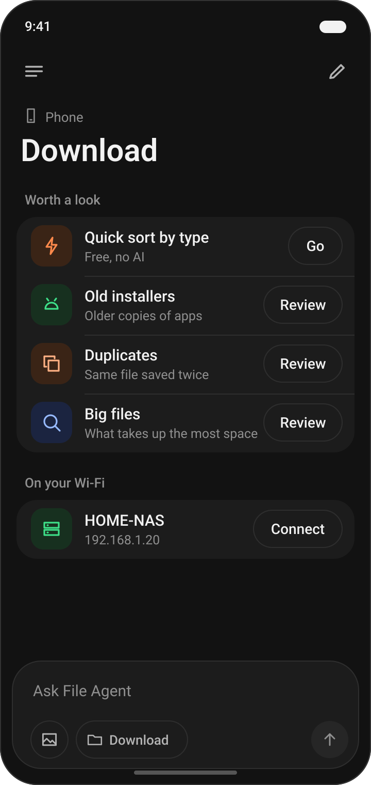
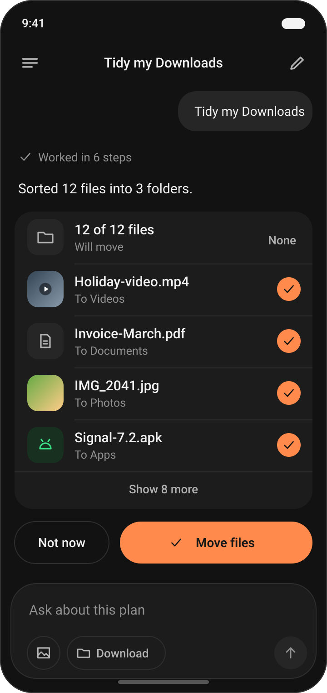
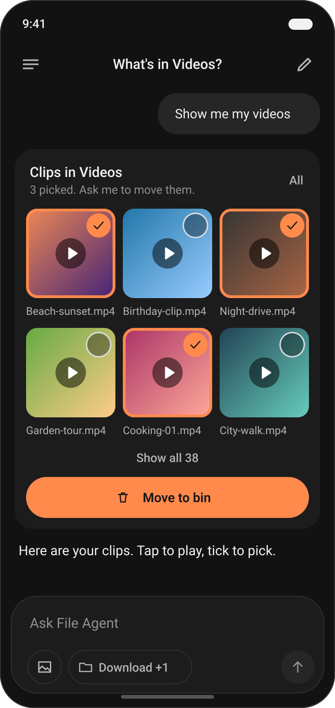
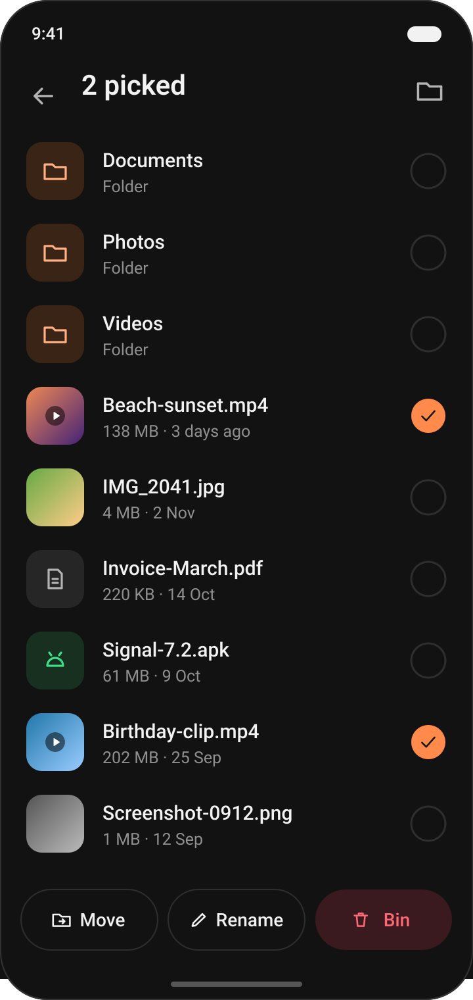

<p align="center">
  
</p>

<h1 align="center">File Agent</h1>

<p align="center">
  An Android app that tidies your files.<br>
  Ask in plain words. It makes a plan. Nothing moves until you say yes.
</p>

<p align="center">
  <a href="https://github.com/offbr0wn/file-agent-kmp/releases/latest/download/FileAgent.apk"><b>⬇️ Download the APK</b></a>
  &nbsp;·&nbsp;
  <a href="https://github.com/offbr0wn/file-agent-kmp/releases/latest">Latest release</a>
</p>

<p align="center">
  
  
  
</p>

<p align="center">
  
  
  
  
</p>

<p align="center"><sub>Preview screens, drawn to match the app.</sub></p>

## What it does

| | |
|---|---|
| ⚡ **Quick sort** | Sorts a messy folder by file type in one tap. Free, no AI needed. |
| 💬 **Ask in plain words** | "Find old installers", "What takes up the most space?", "Move these to my NAS". |
| ✅ **You approve everything** | Every change is shown as a plan first. Tick or untick each file. |
| ↩️ **Undo** | Any change can be undone. Deletes go to a bin for 7 days. |
| 📂 **File manager** | Browse, move, rename and bin files. |
| 👀 **Built-in viewer** | Photos, video, audio, PDF and text open inside the app. |
| 🗄️ **NAS support** | Finds SMB drives on your Wi-Fi. Videos play straight from the NAS. |
| 🖼️ **Pictures in chat** | Attach a screenshot and ask about it. |
| 🔄 **In-app updates** | The app tells you when a new build is ready. |

## Install

1. On your Android phone (Android 11 or newer), tap **[Download the APK](https://github.com/offbr0wn/file-agent-kmp/releases/latest/download/FileAgent.apk)**.
2. Open the file. If Android asks, allow installs from your browser.
3. Open File Agent and follow the short welcome guide.

After that, updates arrive inside the app.

## The AI part is optional

Quick sort, the file manager and the viewer work with no setup.

To chat with the AI, add your own key in **Settings → AI**:

| Provider | Get a key |
|---|---|
| Claude | [console.anthropic.com](https://console.anthropic.com) |
| DeepSeek | [platform.deepseek.com](https://platform.deepseek.com) |

The app loads the list of models from your provider and shows which ones can see pictures.

## Safety and privacy

- **Nothing moves without a yes.** The AI can only propose changes.
- **It only sees folders you tick.** App data and hidden folders are blocked.
- **Delete means bin.** Files wait 7 days before they are gone, unless you empty the bin.
- **Your files stay on your phone.** With AI chat on, file names (and pictures you attach) are sent to the AI provider you chose. Nothing else leaves the device.
- **Keys and passwords are encrypted** with the phone's secure hardware and kept out of backups.
- **No accounts, no ads, no tracking.**

## How it works

```
You: "Tidy my Downloads"
        │
        ▼
AI looks around (read only)  →  builds a plan
        │
        ▼
You review the plan  →  tick / untick  →  approve
        │
        ▼
Files move  →  an undo record is saved
```

<details>
<summary><b>For developers</b></summary>

### Layout

| Path | What |
|---|---|
| `shared/commonMain/agent` | Agent loop, tools, plan, executor, undo |
| `shared/commonMain/llm` | `LlmClient` and the Anthropic-format client (Ktor) |
| `shared/commonMain/rules` | `RuleSorter`, the no-AI quick sort |
| `shared/androidMain/fs` | Phone and SMB file systems behind one "places" interface |
| `androidApp` | Jetpack Compose UI, view model, background service, updater |

### Build

```bash
./gradlew :shared:testDebugUnitTest   # tests, with a fake AI and fake file system
./gradlew :androidApp:assembleRelease # the APK
```

Every push to `main` builds the app in GitHub Actions and publishes it as a release, which is what the in-app updater reads. The signing key is a repository secret (`SIGNING_KEYSTORE_B64`).

### Tech

Kotlin Multiplatform · Jetpack Compose · Ktor · smbj · Material 3

</details>
